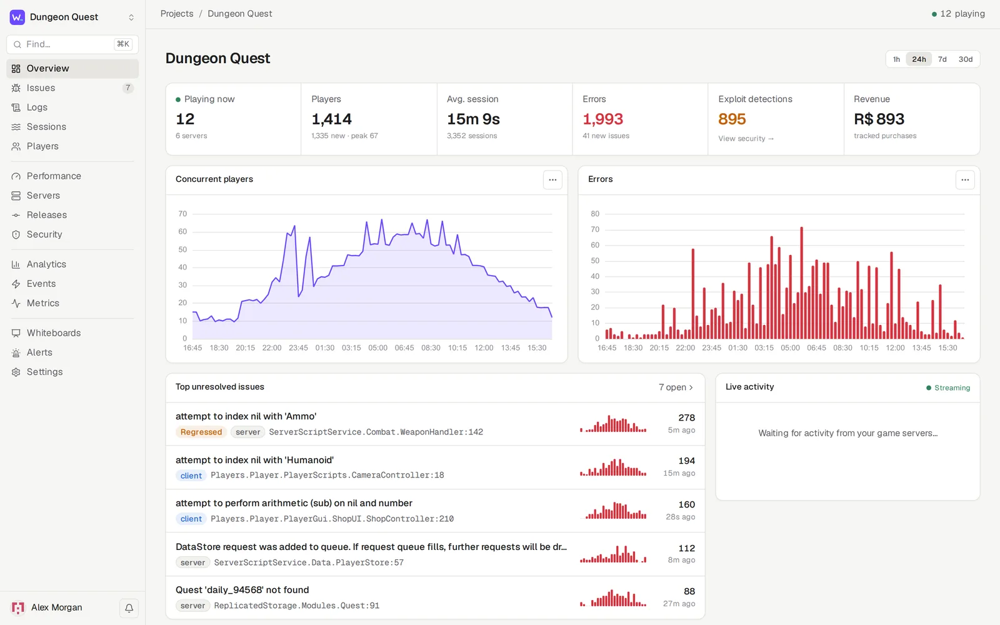
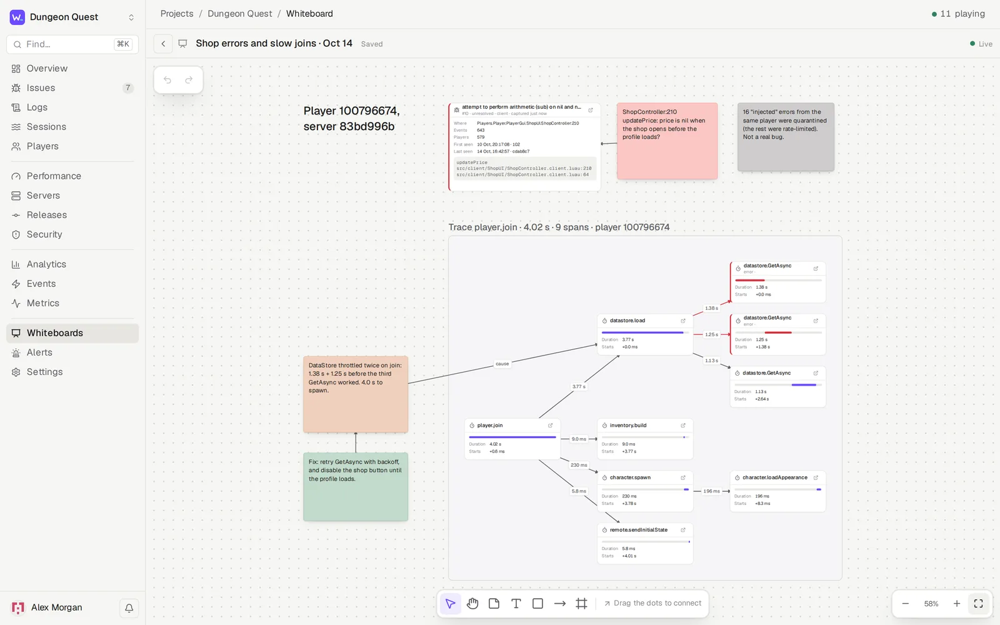
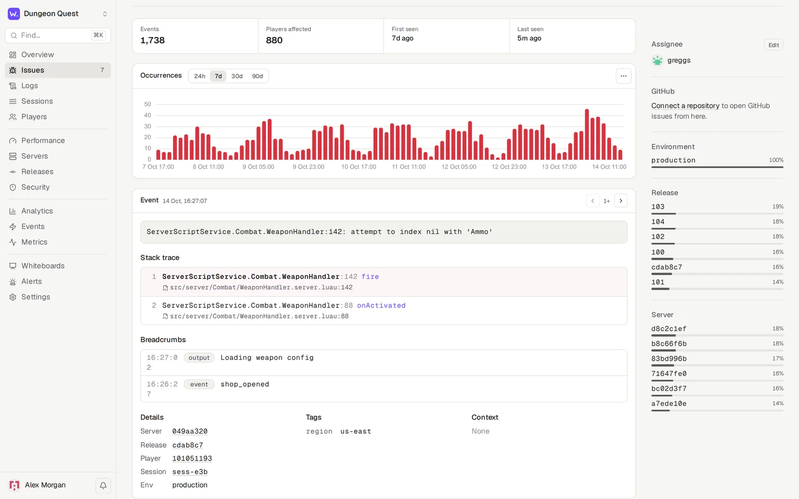
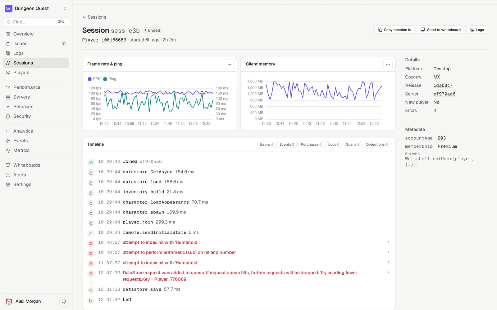
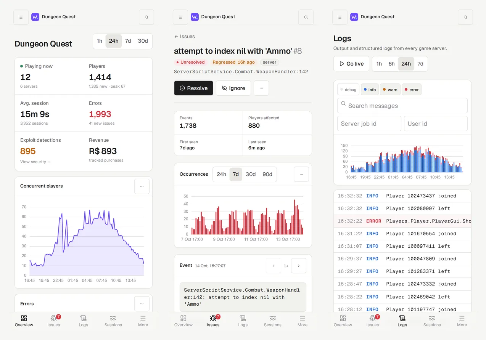

<p align="center">
  
</p>

<h1 align="center">Workshell</h1>

<p align="center">
  Self-hosted error tracking, logs, sessions, performance, anti-exploit and analytics for Roblox games.<br>
  One Go binary. SQLite. Your server.
</p>

<p align="center">
  <a href="https://workshell.shellworks.dev">Website</a> ·
  <a href="https://workshell.shellworks.dev/docs/">Docs</a> ·
  <a href="#quick-start">Quick start</a> ·
  <a href="#install-the-sdk">SDK</a> ·
  <a href="#security">Security</a> ·
  <a href="#configuration">Configuration</a> ·
  <a href="LICENSE">License</a>
</p>

<p align="center">
  <picture><source media="(prefers-color-scheme: dark)" srcset="docs/screenshots/overview-dark.webp"></picture>
</p>

## Why Workshell

Roblox gives you very little visibility into what your live servers are doing. Workshell gives you the Sentry-style setup that other platforms take for granted. Drop in a Luau module and you see every error with a real stack trace, every player session from join to leave, server health, slow operations, and players trying to exploit you. It all runs on a machine you control.

## Features

<table>
<tr>
<td width="50%" valign="top">

 **Issues**<br>
Server and client errors grouped by cause. Stack traces map to your source files through Rojo sourcemaps, with breadcrumbs, affected players and the release that introduced each one. Workshell detects regressions. Assign, comment with @mentions, and open linked GitHub issues.

 **Logs**<br>
All server output plus structured logs. Search, filter by server or player, and tail them live.

 **Sessions & players**<br>
Every play session on one timeline: events, logs, errors, traces, purchases, exploit detections and client FPS, ping and memory.

 **Performance**<br>
`Workshell.trace` spans with p50 and p95 timings. Open any slow run as a waterfall of nested spans. Also shows client frame rate and ping by platform, and server health.

</td>
<td width="50%" valign="top">

 **Releases**<br>
Every version your servers run, with its git commit, the issues it introduced and its error-free session rate.

 **Security**<br>
Exploit detections from `Workshell.flag`, validated and rate-limited remotes, automatic flood detection, and optional pseudonymous (HMAC-hashed) player ids.

 **Analytics & alerts**<br>
CCU, DAU, retention, platforms, countries, Robux revenue, custom events, funnels and metrics. Alert rules deliver to Discord or any webhook.

 **Whiteboards**<br>
Lay out an investigation on a shared canvas. Combine sticky notes and arrows with snapshots of charts, issues, sessions, logs and traces sent from anywhere in the dashboard. Pin notes to points on any chart.

</td>
</tr>
</table>

<p align="center">
  <picture><source media="(prefers-color-scheme: dark)" srcset="docs/screenshots/whiteboard-dark.webp"></picture>
  <br><sub>A whiteboard: a chart with a pinned note, the regressed issue, theories on stickies, and a slow <code>player.join</code> trace drawn as a node graph with span durations.</sub>
</p>

<details>
<summary><b>More screenshots</b></summary>
<br>

| Issue | Session |
| --- | --- |
| <picture><source media="(prefers-color-scheme: dark)" srcset="docs/screenshots/issue-dark.webp"></picture> | <picture><source media="(prefers-color-scheme: dark)" srcset="docs/screenshots/session-dark.webp"></picture> |

<p align="center"><picture><source media="(prefers-color-scheme: dark)" srcset="docs/screenshots/mobile-dark.webp"></picture></p>

The dashboard is an installable PWA that works on phones. It comes in light and dark themes, plus Catppuccin, Rosé Pine, Nord and Gruvbox.

</details>

## Quick start

**Prebuilt binary** (Linux and macOS; Windows builds are on the [releases page](https://github.com/Shellworks-Development/workshell/releases))

```sh
curl -fsSL https://raw.githubusercontent.com/Shellworks-Development/workshell/master/install.sh | sh
workshell         # serves on :8080 and stores data in ./data
```

The script downloads the latest release for your platform, checks it against the release's `SHA256SUMS`, and installs it to `/usr/local/bin` or `~/.local/bin`. The same binary is the server and the `workshell release` CLI.

**Docker**

```sh
git clone https://github.com/Shellworks-Development/workshell && cd workshell
# set WORKSHELL_PUBLIC_URL in docker-compose.yml, then:
docker compose up -d
```

**From source** (Go 1.26+, Node 22+, pnpm)

```sh
make build        # builds the dashboard into a single binary at bin/workshell
./bin/workshell   # serves on :8080 and stores data in ./data
```

Open `http://localhost:8080`, create the admin account, then create a project. You can also open it from your phone at `http://<your-LAN-IP>:8080`.

> [!IMPORTANT]
> Roblox game servers can't reach `localhost`. A live game needs Workshell on a public URL, ideally HTTPS behind a reverse proxy such as Caddy, nginx or a Cloudflare Tunnel. For a quick test, `cloudflared tunnel --url http://localhost:8080` works.

Want to look around first? `make sim KEY=wsk_...` sends about a week of simulated traffic. `make sim-live KEY=wsk_...` streams live traffic from mock game servers. For a fast backfill, raise the project's ingest limit under **Settings → Security** first.

## Install the SDK

1. Download `Workshell.rbxmx` from your project's **Settings → SDK setup** (or `Workshell.rbxm` from the [latest release](https://github.com/Shellworks-Development/workshell/releases/latest)) and put it in **ReplicatedStorage**, or sync `sdk/` with Rojo or Wally.
2. Turn on **Game Settings → Security → Allow HTTP Requests**.
3. Start it from a server Script:

```lua
local Workshell = require(game.ReplicatedStorage.Workshell)

Workshell.init({
	url = "https://workshell.example.com",
	key = "wsk_...",               -- or HttpService:GetSecret("workshell_key")
	signingSecret = "wss_...",     -- optional; see Security
})
```

4. Optionally, `require` it from a LocalScript too. That adds client errors, device type and client FPS, ping and memory.

With no further code, Workshell captures uncaught server and client errors, server output, player sessions (country, platform, account metadata), server health and client performance every 30 seconds, game pass purchases, and a final flush on shutdown.

<details>
<summary><b>SDK reference</b></summary>
<br>

```lua
-- Logs
Workshell.info("Round started", { map = "Desert" })
Workshell.warn("DataStore budget low", { budget = 3 }, player)

-- Errors
Workshell.captureError(err, { player = player, tags = { store = "PlayerData" }, context = { attempt = 3 } })
local ok, result = Workshell.try(loadData, player)        -- pcall that reports failures
Workshell.setContext("round", { map = "Desert" })          -- attached to every error
Workshell.addBreadcrumb("Opened shop", "ui")

-- Sessions & analytics
Workshell.setUser(player, { level = 12, guild = "Red" })   -- session metadata
Workshell.track("level_up", { level = 5 }, player)
Workshell.trackPurchase(player, receipt.CurrencySpent, { productId = receipt.ProductId })

-- Performance: spans, with nested children forming a trace
local data = Workshell.trace("datastore.load", function() return store:GetAsync(key) end, player)
local join = Workshell.startSpan("player.join", { player = player })
local load = join:child("datastore.load")
load:setAttribute("store", "PlayerData"); load:finish()
join:finish()

-- Security
Workshell.flag(player, "speed", { speed = 90, max = 32 }, { severity = "high", action = "kicked" })
Workshell.protect(remotes.BuyItem, function(player, itemId) ... end, {
	rate = 5,                                               -- calls/second per player
	validate = function(player, itemId) return typeof(itemId) == "string" end,
})

-- Metrics
Workshell.increment("shop.opened")
Workshell.gauge("matchmaking.queue", #queue)
```

Clients can call `track`, `captureError`, `try` and `addBreadcrumb`. Client data goes through a rate-limited RemoteEvent and is marked `$client = true`. Clients can't send `$`-prefixed events such as `$purchase`, and detections can only come from the server.

</details>

## Releases and Rojo

Install the binary in CI (the install script above works on Linux and macOS runners), then run `workshell release` before `rojo build`:

```sh
WORKSHELL_URL=https://workshell.example.com WORKSHELL_KEY=wsk_... \
  workshell release -project default.project.json -out src/shared/WorkshellRelease.json
```

It records the git commit, branch, message and author. It writes `WorkshellRelease.json`, which Rojo syncs as a ModuleScript and the SDK picks up, so every error and session is tagged with the commit. Then it uploads a Rojo sourcemap. After that, a frame like `ServerScriptService.Combat.Weapon:42` shows as `src/server/Combat/Weapon.server.luau:42`, linked to GitHub at that exact commit when a repository is connected.

## Security

Exploiters can reach Workshell only through your game's clients, and they will try. Workshell assumes it.

- **Signed requests.** With a signing secret, each batch is signed with HMAC-SHA256 over a timestamp and the body. With "require signed requests" on, a leaked ingest key alone can't forge or replay data.
- **Flood limits.** Client data is capped per player, and floods are dropped and recorded as `client_flood` detections. A flagged player's client-only errors are quarantined so they can't bury real issues. Server logs are capped per server, and each project has an ingest rate limit.
- **Safe rendering.** All user-supplied text renders as text, never HTML. A strict Content-Security-Policy forbids inline and third-party scripts. Control and bidi characters are stripped at ingest, and alerts can't ping `@everyone`.
- **Secrets at rest.** Webhook URLs, GitHub tokens and signing secrets are encrypted with AES-256-GCM.
- **Accounts and changes.** Login throttling, an audit log of sensitive changes, and HttpOnly/SameSite session cookies.

## Configuration

| Variable | Default | |
| --- | --- | --- |
| `WORKSHELL_ADDR` | `:8080` | Listen address |
| `WORKSHELL_DATA_DIR` | `./data` | SQLite database and generated secret key. **Back this up.** |
| `WORKSHELL_PUBLIC_URL` | | Public URL, used in setup snippets and alert links |
| `WORKSHELL_SECRET_KEY` | generated | 32-byte hex or base64 key that encrypts stored secrets |
| `WORKSHELL_REDIS_URL` | | e.g. `redis://localhost:6379/0`: a durable ingest queue that survives restarts, and live updates shared between instances. The database is still one SQLite file. |
| `WORKSHELL_SECURE_COOKIES` | `false` | Set to `true` when served over HTTPS |
| `WORKSHELL_TRUST_PROXY` | `false` | Trust `X-Forwarded-*` headers from a reverse proxy |
| `WORKSHELL_MAX_INGEST_BYTES` | `8388608` | Maximum decompressed ingest request size |
| `WORKSHELL_SESSION_DAYS` | `30` | Dashboard login lifetime |

Retention is set per project. By default logs, traces and health data are kept for 14 days, and errors, events, sessions and detections for 90 days. Whiteboard snapshots are kept until you delete them.

### Capacity

Workshell stores everything in one SQLite database with a single writer. Redis makes the ingest queue durable; it does not make the database scale horizontally. Measured on one machine (an 8-core Ryzen 7 5700X), with 100 simulated game servers sending 1.1 million items over 9 minutes while six dashboard pages were polled throughout:

- Ingest kept up the whole time; everything was written within 2 seconds of the last send, and nothing errored.
- Issues, logs and sessions answered in about 11 ms or less (p95). The overview answered in about 230 ms, server health in about 360 ms, and the performance page, which scans a day of traces, in about 760 ms (all p95).

Expect the analytics-style pages (performance, server health) to slow down as a project's history grows into tens of millions of rows. Load-test with your own traffic before relying on it for a large game.

## Development

```sh
make dev        # server on :8080
make dev-web    # dashboard with hot reload on :5173, reachable on your LAN for phone testing
make test       # Go tests, dashboard type check, SDK tests (needs `luau`)
```

<details>
<summary><b>Repository layout and ingest protocol</b></summary>
<br>

| Path | |
| --- | --- |
| `cmd/workshell` | The server and the `workshell release` CLI |
| `cmd/workshell-sim` | Traffic simulator, with mock game servers, players, cheaters and traces |
| `internal/server` | Ingest, grouping, collaboration, sessions, releases, performance, security, alerts, whiteboards |
| `internal/pipeline` | Ingest queue and live broker (in-memory or Redis) |
| `internal/secure` | Encryption and HMAC |
| `internal/db` | Schema and migrations |
| `web/` | Vue 3 + Vite + Tailwind dashboard (PWA), embedded into the binary |
| `sdk/` | The Luau SDK; `sdk/test` runs it against Roblox API mocks |

`POST /api/v1/ingest` with `X-Workshell-Key`, plus `X-Workshell-Timestamp` and `X-Workshell-Signature: v1=<hex hmac>` when signing, returns `202`. Item types are `error`, `log`, `event`, `session_start`, `session_update`, `session_end`, `heartbeat`, `metric`, `span`, `detection`, `client_perf` and `server_close`; the fields are in `internal/server/ingest.go`. The server ignores unknown types, so older servers accept newer SDKs.

</details>

## License

[PolyForm Shield 1.0.0](LICENSE). You can use, modify and self-host Workshell for anything, including commercially, except to offer a product that competes with Workshell.

Required Notice: Copyright 2026 Shellworks Development
